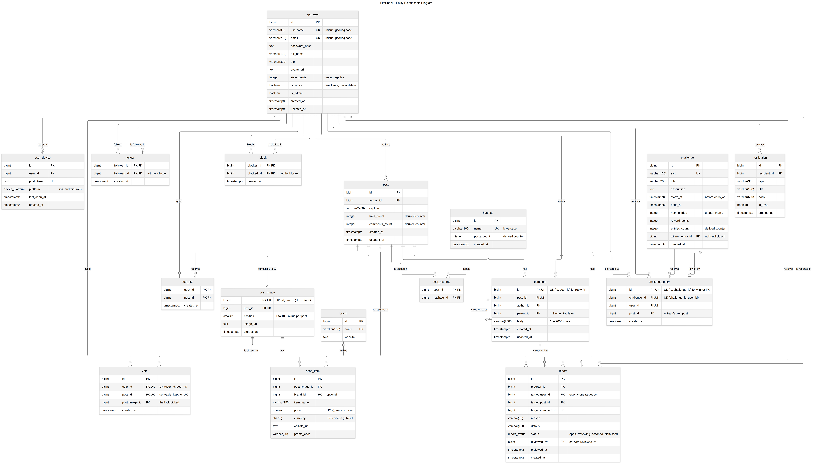

# Portfolio 1: Database Design and Modelling

**Case study:** FitsCheck. **Status:** Complete.

**Brief requires:** chosen case study description, ER diagram, relational schema, keys, constraints, and normalisation explanation.

## 1. Objective

Design and implement the relational core of FitsCheck, an outfit-rating social platform: identify its
business rules, model them in an ER diagram, normalise the design, and implement it in PostgreSQL so
that the database itself, not the application, enforces as many rules as possible. Every rule is then
proven by a test that tries to break it.

## 2. What I built

### 2.1 Business rules
Twenty rules define what the database must guarantee, each tagged with where it is enforced:
declarative constraint, trigger, or transaction. See [business-rules.md](business-rules.md).

### 2.2 Entity relationship diagram



Source: [diagrams/fitscheck-erd.mmd](diagrams/fitscheck-erd.mmd), written in Mermaid and rendered locally
with the Mermaid CLI using the ELK layout engine. GitHub also renders the source file directly. To
re-render after a change:

```bash
npx -y -p @mermaid-js/mermaid-cli mmdc -i diagrams/fitscheck-erd.mmd -o diagrams/fitscheck-erd.png --size 5000 -s 2
```

17 tables in five areas: **social** (users, devices, follows, blocks), **content** (posts, images,
shop items, brands, hashtags), **engagement** (likes, votes, comments), **challenges** (challenges,
entries) and **moderation** (reports, notifications).

How to read it (crow's foot notation): the symbol at each end of a line shows how many rows can be
on that side. `||` means exactly one, `o|` zero or one, `o{` zero or many and `|{` one or many. The
line from `post` (`||`) to `post_image` (`|{`) reads "one post contains one or more images". Every many-to-many relationship (follows, likes, votes, post hashtags) is resolved into a
junction table, so no line is many-to-many.

Design points visible in the diagram:
- **Composite foreign keys** keep related rows consistent. A vote's `(post_image_id, post_id)` must
  match an image of that same post (BR-11). A reply's `(parent_id, post_id)` must match a comment on
  the same post (BR-13). A challenge's `(winner_entry_id, id)` must match an entry of that same
  challenge (BR-17).
- **Self-relationships**: `follow` and `block` link users to users; `comment.parent_id` links
  replies to comments.
- **Circular reference** between `challenge` and `challenge_entry`: entries belong to a challenge,
  and the challenge points back at its winning entry. The winner is nullable because no entry exists
  when a challenge is created.
- **Delete behaviour** is deliberate: deleting a post cascades to its images, likes, votes and
  comments, but user references restrict, because accounts are deactivated rather than deleted
  (BR-05).
### 2.3 Normalisation
[normalisation.md](normalisation.md) derives the schema from one flat "post a fit" record through
1NF, 2NF and 3NF, then tests every relation against BCNF. Three relations deliberately keep a
redundant column so a business rule can be a `UNIQUE` constraint: `vote` and `challenge_entry` are in
3NF but not BCNF, and `comment` keeps `post_id` for replies. In each case a composite foreign key
stops the redundant value from ever being wrong. The analysis also replaced a planned trigger (BR-15)
with a declarative composite foreign key. Stored counters are deliberate denormalisation, justified
and controlled.

### 2.4 Data dictionary
[data-dictionary.md](data-dictionary.md) documents every table, column, type, default, key,
constraint, index and trigger. It is **generated from the PostgreSQL catalog** by
[07_data_dictionary.sql](sql/07_data_dictionary.sql), and the descriptions are stored in the database
itself with `COMMENT ON` ([06_comments.sql](sql/06_comments.sql)). The dictionary therefore cannot drift
from the real schema: changing the schema and regenerating updates it.

## 3. How to run

From the repository root, with the stack running (`docker compose up -d postgres`) and `.env` loaded
(`set -a; . ./.env; set +a`):

```bash
psql "$PG_URL" -v ON_ERROR_STOP=1 -f portfolio-1-database-design/sql/01_schema.sql
psql "$PG_URL" -v ON_ERROR_STOP=1 -f portfolio-1-database-design/sql/02_constraints.sql
psql "$PG_URL" -v ON_ERROR_STOP=1 -f portfolio-1-database-design/sql/03_triggers.sql
psql "$PG_URL" -v ON_ERROR_STOP=1 -f portfolio-1-database-design/sql/04_views.sql
psql "$PG_URL" -v ON_ERROR_STOP=1 -f portfolio-1-database-design/sql/06_comments.sql
```

Regenerate the data dictionary:

```bash
psql "$PG_URL" -X -q -At -f portfolio-1-database-design/sql/07_data_dictionary.sql > portfolio-1-database-design/data-dictionary.md
```

| Script | Contents |
|---|---|
| [01_schema.sql](sql/01_schema.sql) | Schema `fitscheck`, enum types, 17 tables with primary keys and defaults |
| [02_constraints.sql](sql/02_constraints.sql) | Alternate keys, checks and foreign keys, all named |
| [03_triggers.sql](sql/03_triggers.sql) | Cross-table rules (BR-03, BR-12) and `updated_at` stamping |
| [04_views.sql](sql/04_views.sql) | `v_post_card` (feed card) and `v_counter_drift` (counter reconciliation, BR-20) |
| [05_constraint_tests.sql](sql/05_constraint_tests.sql) | Rule-breaking tests; rolled back (section 4) |
| [06_comments.sql](sql/06_comments.sql) | `COMMENT ON` descriptions for the schema, every table, column, type and view |
| [07_data_dictionary.sql](sql/07_data_dictionary.sql) | Generates `data-dictionary.md` from the catalog |

To start again from empty: `psql "$PG_URL" -c "DROP SCHEMA fitscheck CASCADE"`.
## 4. How it was tested

[05_constraint_tests.sql](sql/05_constraint_tests.sql) attacks every declarative and trigger rule in
[business-rules.md](business-rules.md) with data that breaks it:

1. It loads a small valid fixture (five users, posts, images, likes, votes, comments, challenges and
   entries). The fixture loading at all proves valid data is accepted.
2. Each test runs one rule-breaking statement inside a subtransaction. A helper catches the error and
   records **which constraint actually fired** (or the SQLSTATE for errors that carry no constraint
   name, such as NOT NULL). A test passes only if the expected constraint is the one that rejected it,
   not merely if some error occurred.
3. Behaviour that is not a rejection is checked with a true/false query: blocking removes an existing
   follow, deleting a brand nulls its items, deleting a post cascades to its children, editing a post
   stamps `updated_at`, and `v_counter_drift` catches a tampered counter.
4. The whole run is one transaction that is rolled back, so it can be repeated on any database,
   including a seeded one, and leaves nothing behind.

```bash
psql "$PG_URL" -X -q -v ON_ERROR_STOP=1 -f portfolio-1-database-design/sql/05_constraint_tests.sql
```
## 5. Results and evidence

| Evidence | What it shows |
|---|---|
| [p1_constraint_tests_all_rules_enforced.txt](evidence/p1_constraint_tests_all_rules_enforced.txt) | **50 of 50 tests pass**: every rule-breaking insert, update or delete was rejected by the intended named constraint or trigger, with its SQLSTATE. 3 further rules are listed as enforced by transactions in Portfolio 3. |

SQLSTATE codes seen in the evidence: `23505` unique violation, `23503` foreign key violation, `23514`
check violation (also raised by the triggers), `23502` NOT NULL violation and `22P02` invalid enum value.

Rules enforced by transactions rather than the schema, and therefore tested in Portfolio 3:
BR-07 (at least one image per post), BR-16 (entries only while open and within the limit) and BR-17
(winner set only after the challenge ends).
## 6. Analysis

**Where each rule lives is a design decision.** Of the 20 business rules, most are declarative
(primary keys, unique keys, checks and foreign keys), two need triggers because they must read another
table (BR-03 blocking, BR-12 no self-votes), and three depend on time or on counting rows under
concurrency, so they belong in transactions (Portfolio 3). Declarative constraints were preferred
wherever possible: they cannot be bypassed by any client, they are checked on every write, and the
planner can rely on them.

**Composite foreign keys enforce cross-row consistency declaratively.** Four rules that look like
they need triggers ("the voted image belongs to the voted post", "a reply is on its parent's post",
"an entry uses the entrant's own post", "the winner is an entry of this challenge") are each a
composite foreign key backed by a unique key that is logically redundant but required by PostgreSQL.
The normalisation analysis is what revealed BR-15 as an instance of this pattern, replacing a planned
trigger with a constraint.

**Normalisation was taken to BCNF and deliberately stopped at 3NF in two places.** `vote` and
`challenge_entry` keep a derivable column so that "one per user" stays a `UNIQUE` constraint; a BCNF
decomposition would lose that dependency. The redundancy is harmless because a composite foreign key
stops it from ever holding a wrong value. This is the trade-off between BCNF and dependency
preservation in practice.

**Denormalised counters trade write cost and drift risk for read speed.** Feed cards show like and
comment counts on every view, so they are stored rather than counted. `v_counter_drift` makes drift
detectable; Portfolio 2 measures the read benefit and Portfolio 3 shows how concurrent updates corrupt
a naively maintained counter and how to prevent it.
## 7. Limitations and next steps

- **Transaction rules are not enforced by the schema alone.** A post can be inserted without images,
  an entry made after a challenge closes, and a winner set early, unless writes go through the
  transactions built in Portfolio 3. A deferred constraint trigger could enforce "at least one image"
  at commit time; it was left out to keep the rule in the posting transaction.
- **Deleting a post deletes reports about it** (cascade). Moderation history would be better kept with
  soft-deleted posts (`deleted_at`) instead of hard deletes.
- **Users are deactivated, never deleted.** This protects votes and challenge history but needs a
  separate anonymisation process to meet a data-erasure request.
- **Format checks are sanity checks.** The email regex rejects obvious mistakes only; real validation
  is a confirmation email.
- **No secondary indexes yet** beyond keys. Indexes are chosen from measured query plans in
  Portfolio 2.
